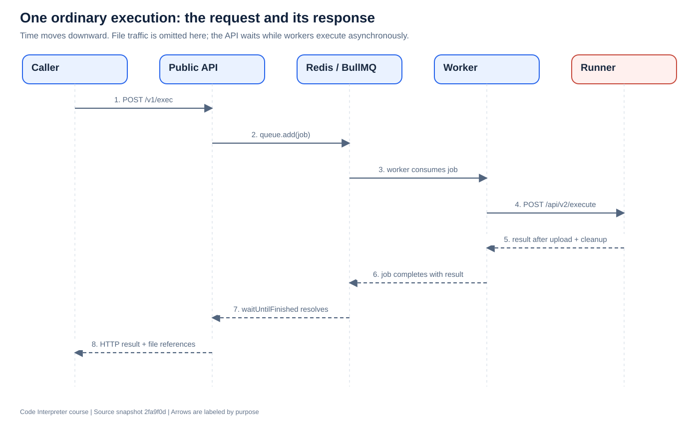

# 3. Trace one execution from request to response

[Previous](02-repository-map.md) · [Course home](README.md) · [Next](04-sandbox.md)

**Objective:** Trace the ordinary `/v1/exec` path and identify the exact functions responsible for each handoff.

## Start with the request

This is an illustrative JSON body; authentication and file references must come from an authorized caller:

```json
{
  "lang": "py",
  "code": "print('hello from the sandbox')"
}
```

The public API's `/v1` router mounts the handler registered as `/exec` in [`service/router.ts`](../../service/src/service/router.ts#L171). Therefore its full path is `/v1/exec`.

Authentication middleware runs before the service router. The handler derives the trusted principal, resolves language, checks lifecycle state, and authorizes any input-file references. A user ID supplied in JSON is not a substitute for the authenticated principal.



The diagram omits file download/upload traffic to keep the job handoffs visible. Lesson 5 adds it back.

## API preparation

1. `resolveLanguage()` maps the caller's language to a supported configuration.
2. `authorizeRequestedFiles()` checks input-file access.
3. `resolveOutputBucketSessionKey()` and `recordSessionOwnership()` establish output ownership.
4. `createPayload()` builds the sandbox payload: runtime selection, source file, optional input references, arguments, and memory limit.
5. `prepareSandboxJobSecurity()` creates the claims needed for later signing and gateway permissions.
6. `queue.add()` places the job in BullMQ. Python and other languages use separate queue lanes.
7. `job.waitUntilFinished()` waits for the corresponding queue completion event before replying.

These steps form a sequence, not one giant direct function call. Some names are imported helpers; `queue.add()` and `waitUntilFinished()` are BullMQ methods.

`createPayload()` also has special handling for plotting code, using a Python template. This is a compatibility behavior in payload preparation, not the sandbox's fundamental execution mechanism.

## Worker preparation and execution

BullMQ workers invoke the private `processJob()` function in [`workers.ts`](../../service/src/workers.ts). It establishes tracing and delegates to `processJobInner()`.

The inner function checks the remaining deadline and verifies that the queued profile/backend matches the worker. In the hardened gateway path it requests an execution-scoped egress grant using `createGatewayEgressGrant()`.

`prepareInputDelivery()` separates the signed request from any control-plane-only input information. `buildSandboxExecuteRequest()` creates the transport body and signs it. The selected backend receives that request through `getSandboxBackend().execute()`.

For the HTTP backend, `HttpSandboxBackend.execute()` posts to the configured sandbox endpoint, normally `/api/v2/execute`. It forwards the worker's abort signal. The runner performs the actual language execution, covered in the next lesson.

After execution, the worker restores gateway-scoped handles into caller-facing file references, normalizes the result, and returns it to BullMQ. Its completion and failure paths also handle grant revocation, timers, metrics, and cancellation bookkeeping. They are important parts of correctness, not decorative logging.


## Result and failure paths

The ordinary execution result includes captured process output and file references. Consult [`types/service.ts`](../../service/src/types/service.ts) for the full shapes: public responses and internal runner responses are not identical.

Distinguish four failure locations:

| Location | Example | Consequence |
|---|---|---|
| Before enqueue | Unsupported language or unauthorized file | No execution should begin |
| Queue/worker | Deadline expires while waiting | Worker must not grant a fresh full budget |
| User process | Syntax error or nonzero exit | Execution result can describe the program failure |
| Artifact delivery | Chart created but upload fails | Response must not advertise an unavailable file as delivered |

The ordinary route configures one queue attempt. Other recovery mechanisms can still matter; this is not a general exactly-once guarantee. A client disconnect is also not proof that every underlying process has already stopped. Programmatic cancellation has additional explicit bookkeeping.

## Read the source

Read [the handler](../../service/src/service/router.ts#L171), [`createPayload`](../../service/src/payload.ts), [`processJobInner`](../../service/src/workers.ts), [`buildSandboxExecuteRequest`](../../service/src/sandbox-dispatch.ts), then [`HttpSandboxBackend.execute`](../../service/src/sandbox-backend/http.ts). Keep that order.

**Exercise:** Write down what information crosses each boundary: API → Redis, worker → runner, runner → worker. Mark which fields must be trusted or signed.

**Checkpoint:** If a job spends 20 seconds waiting against a 25-second worker budget, why is giving it another 25 seconds at backend entry incorrect?
