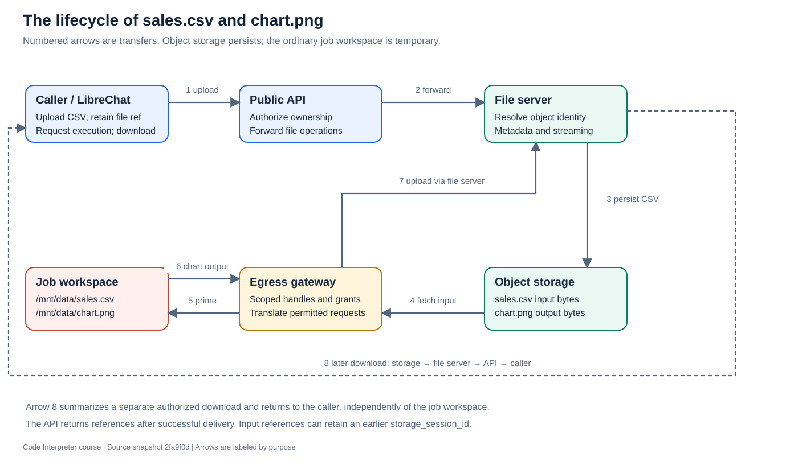

# 5. Files, identities, and state

[Previous](04-sandbox.md) · [Course home](README.md) · [Next](06-security.md)

**Objective:** Follow a file through its full lifecycle and distinguish file persistence from runtime persistence.

## Follow the CSV and chart



First the authorized caller uploads `sales.csv` through the public API. That API forwards the file to the internal file server, which streams it into S3 or MinIO. The caller receives a file reference.

The execution request includes that reference. The public API authorizes it; the gateway issues restricted handles for the sandbox. During priming, the runner fetches the file through the gateway and writes it into `/mnt/data`.

Python reads the local file and writes `chart.png`. The runner uploads the generated chart through the gateway, and the response includes a persistent reference. Later the user downloads the chart through the public API. The chart must survive even though the per-execution workspace is cleaned.

## Understand the identifiers

| Name | Meaning | Do not confuse it with |
|---|---|---|
| `execution_id` | Identity used to coordinate an execution/workflow | An object-storage key |
| Top-level `session_id` | Scope of an execution response | A guarantee that Python memory persists |
| `storage_session_id` | Namespace/prefix for stored files | The ID of whichever execution is running now |
| File `id` | Logical identity of one file object | Its human-readable filename |
| `runtime_session_id` | Binding used for an execution environment in supported stateful backends | A plain storage-session identifier |
| Gateway handle | Restricted representation used across the sandbox boundary | A storage credential or caller-facing permanent reference |

On the ordinary execution path, a new execution session ID also becomes the output storage prefix. Those values intentionally coincide for that run. They still have different meanings, and input files can belong to earlier storage sessions.

## What the file server actually stores

[`uploadFile()`](../../service/src/file-server.ts) chooses a logical file ID and storage key, records metadata, uploads the bytes, and updates Redis hints. Metadata includes the original filename, content type, read-only status when relevant, and a fresh `codeapi-version` marker.

For replacement uploads, `storageKeyForUpload()` uses a canonical key shaped like:

```text
<session>/.codeapi-objects/<base64url(file-id)>
```

Legacy objects can use `<session>/<file-id>.<extension>`. [`FileObjectResolver`](../../service/src/file-object-resolver.ts) understands both. The optional Redis object index is a locator hint; the object store remains authoritative for object metadata and existence.

A changed filename extension must not accidentally create two independent “current” objects for the same logical identity. That is why canonical replacement keys and legacy-sibling handling matter.

## Why download metadata must match the bytes

Imagine the runner asks for metadata, another request overwrites the object, and then the runner downloads it. The version it authorized may differ from the bytes it receives.

The implementation uses version markers and download checks to detect changes. [`sendFileDownload()`](../../service/src/file-download.ts) reads metadata associated with the actual GET stream and compares an expected version when provided. A future Blob adapter must preserve this behavior; a separate later metadata request can introduce a race.

Read-only files are infrastructure inputs that should not be surfaced as generated artifacts in the normal way. Read-only metadata is a behavioral signal, not a replacement for filesystem permissions or authorization.

## Four kinds of persistence

| State | Where it lives | What a restart means |
|---|---|---|
| Job coordination and ownership | Redis | Depends on Redis durability, retention, and recovery |
| Uploaded/generated files | Object storage | Independent of a runner's temporary workspace |
| Per-job working directory | Sandbox workspace | Normally removed after execution |
| Stateful workspace/checkpoint | Supported backend's session machinery | Depends on backend lifecycle and checkpoint support |

The Lambda session workspace preserves files, installed packages, and database directories under `/mnt/data`. It does not by itself provide a notebook kernel with persistent Python variables. Its checkpoint store is a separate S3 implementation from ordinary file storage; replacing only the file server does not port that checkpoint path.

## Read the source

Read [`file-server.ts`](../../service/src/file-server.ts), [`file-object-resolver.ts`](../../service/src/file-object-resolver.ts), [`file-download.ts`](../../service/src/file-download.ts), and [`session-workspace.ts`](../../api/src/session-workspace.ts). [Input reuse documentation](../INPUT_REUSE.md) explains further caching behavior.

**Exercise:** A second execution uses the first execution's chart as input. Write the two execution session IDs and the chart's storage session ID. Explain which one stays attached to the chart.

**Checkpoint:** If a runner crashes but object storage is intact, which files can still be retrieved and which local changes may be lost?
