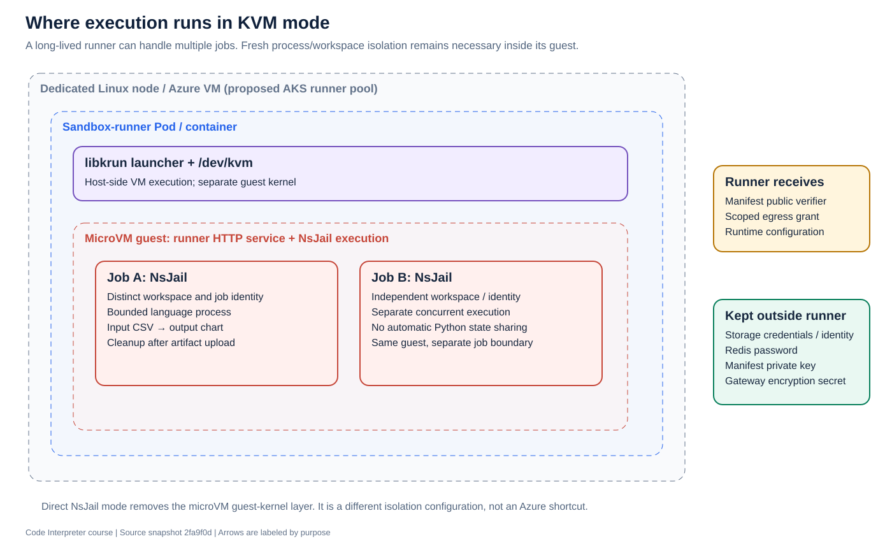

# 6. The security boundaries explain the architecture

[Previous](05-files-and-state.md) · [Course home](README.md) · [Next](07-tools-and-backends.md)

**Objective:** Explain why credentials, authority, and network access are split across services.

## Three different questions

1. **Who is calling?** Public authentication produces a trusted principal.
2. **What may this execution do?** Claims, file authorization, and gateway grants constrain operations.
3. **What can the running program reach?** OS isolation and network policies constrain access even if code misbehaves.

These questions are related, but no single token or container setting answers all three.

## Follow the authority

The public API normally validates LibreChat JWTs through its authentication provider. It derives user and tenant context from trusted identity. The middleware's historical name `apiKeyAuth` should not make you assume the current system only checks a static API key. `LOCAL_MODE` is a separate development path.

The API authorizes input references before enqueueing work. Workers sign sandbox execution manifests. The runner verifies those manifests using its public verifier. The asymmetric key arrangement lets the runner verify authority without receiving the worker's private signing key.

The signed manifest binds the request body. A backend must not modify that body after signing and silently assume the signature still authorizes the changed request.

## Execution manifest versus egress grant

| Mechanism | Purpose | Principal holder |
|---|---|---|
| Caller JWT | Authenticate caller and claims | Caller/public API |
| Internal service token | Authenticate service-to-service management operations | Trusted services |
| Manifest private key | Sign authorized execution requests | Worker |
| Manifest public key | Verify authorized execution requests | Runner |
| Gateway secret | Protect grants and opaque handles | Egress gateway |
| Per-execution egress grant | Permit scoped file/tool operations | Specific execution |
| Storage identity | Access persistent object storage | File server in the proposed Azure design |

`prepareSandboxJobSecurity()` prepares claims. `createGatewayEgressGrant()` asks the gateway to scope access. `buildSandboxExecuteRequest()` signs the request. `verifyExecuteRequestManifest()` verifies it inside the runner. These are separate stages.

Grants are limited by scope and lifetime. The gateway ledger supports revocation and request accounting. A grant expiring is not the same event as stopping a process; both lifecycles need handling.

## Isolation has layers

The guest kernel separates the KVM sandbox from the host kernel. NsJail separates execution processes inside the guest. Per-job identities and safe workspace handling separate concurrent jobs. Resource controls limit how much work a process can consume. Network policies limit service reachability.

The current runner network policy permits gateway and DNS traffic and includes an optional telemetry rule. The gateway delegates to the file and tool servers. Keep that distinction between a simplified logical diagram and the actual rendered allow rules.

A Kubernetes Service only creates a stable endpoint; it does not enforce authorization. A NetworkPolicy only limits network paths; it does not prove a file belongs to a user. Both must work with application-level checks.

## What changes on Azure?

The file server would authenticate to Blob using Workload Identity. That identity belongs to the file server's Pod/service account. Giving it to the sandbox runner would expand the runner's authority beyond its execution-scoped grant.

A private Blob endpoint changes where packets travel. It does not remove the need for storage authorization. Likewise, Azure's infrastructure identity does not replace the worker's execution-manifest signing keys.

## Read the source

Read [`auth/provider.ts`](../../service/src/auth/provider.ts), [`middleware/auth.ts`](../../service/src/middleware/auth.ts), [`sandbox-dispatch.ts`](../../service/src/sandbox-dispatch.ts), [`execution-manifest-request.ts`](../../api/src/execution-manifest-request.ts), [`egress-grant.ts`](../../service/src/egress-grant.ts), and [the NetworkPolicy template](../../helm/codeapi/templates/network-policy.yaml).

**Exercise:** Put each credential in the previous table into one of three boxes: trusted API/worker, sandbox runner, or gateway/file server. Explain each placement.

**Checkpoint:** Why should the runner receive a public verification key and a scoped grant, but not a storage account key or the manifest private key?
