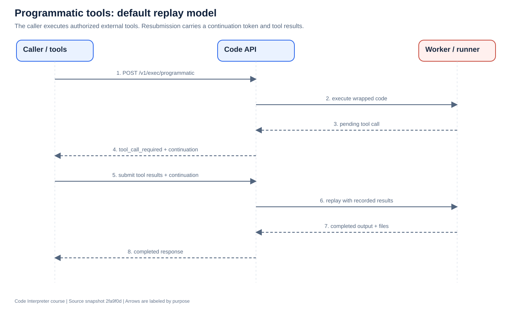

# 7. Tools, execution backends, and advanced features

[Previous](06-security.md) · [Course home](README.md) · [Next](08-deployment.md)

**Objective:** Separate ordinary execution, programmatic tool calling, persistent workspaces, and hosted applications.

## Ordinary execution versus tool calling

Ordinary execution can calculate a total using local input files. Sometimes code also needs a tool supplied by the caller, such as an authorized search function. A tool's name and arguments must cross back to a trusted caller that can execute it with the appropriate permission.

The public endpoint is `/v1/exec/programmatic`. The default `PTC_MODE` in this snapshot is `replay`; a legacy `blocking` path also exists.

In replay mode:

1. The caller submits code and supported tool definitions.
2. The runtime wrapper exposes the declared tools to the program.
3. A call requiring a result is reported as pending work.
4. Code API responds with `status: "tool_call_required"`, pending calls, and a continuation token.
5. The caller executes authorized tools and submits their results with the continuation token.
6. Code API runs a replay using recorded tool results until it completes or needs another call.

“Replay” means portions of user code may execute again. Do not infer exactly-once external effects from it. The protocol, call history, ownership, continuation validation, and cancellation fencing are part of correctness.

`createProgrammaticPayload()` builds the runtime wrapper. `extractPendingFromControlPayload()` and `extractPendingFromStdout()` decode pending calls. The programmatic router coordinates iterations and stored state. The tool call server supports session and callback coordination, particularly the blocking path; the default replay flow should not be pictured as every call waiting inside that server.

In blocking mode, a process can wait for tool results while the tool call server coordinates the round trip. Remote bridge configuration rejects blocking PTC and requires replay. Tool support also varies by language and selected workspace mode; ordinary language support does not guarantee every advanced tool mode is supported.

## Three backends share one interface

[`SandboxBackend`](../../service/src/sandbox-backend/types.ts) provides `execute(request, context)` and an optional `shutdown()`. The worker prepares the request before choosing a backend. The context carries deadlines, cancellation, identity, and optional session routing.

| Backend | Transport/lifecycle | Important distinction |
|---|---|---|
| `http` | POST to an existing runner | Fresh per-job workspace; runner/microVM can remain alive |
| `lambda-microvm` | AWS-specific microVM APIs | Supports stateless launches and session-bound environments |
| `remote-bridge` | Outbound-polling attached worker | Operator-controlled environment, leases, generations, and fencing |

`getSandboxBackend()` selects the implementation. Lambda-specific modules are loaded lazily behind that backend gate. Installing an AWS SDK dependency therefore does not mean the default HTTP path makes AWS API calls.

An **execution profile** (`default` or `stateful`) is a deployment and routing identity. A **backend** is an implementation. A **runtime session mode** (`stateless`, `affinity`, `strict`) determines session expectations. They are separate settings with compatibility checks.

The ordinary default queues are `python-queue` and `other-queue`. Explicit stateful profiles isolate queue names, and remote bridge uses additional dedicated queue naming. Read [`execution-profile.ts`](../../service/src/execution-profile.ts) rather than assuming every worker consumes the same jobs.

## Remote bridge

`packages/code` provides the `@librechat/code` worker CLI. It connects outbound, registers capabilities, polls assignments, invokes a local runtime, and returns results. The VM does not need a public inbound execution port.

A lease identifies the current assignment. A generation increases when ownership changes. **Fencing** rejects stale workers/results even if an old process keeps running. This matters after disconnects, retries, and rolling updates.

Workspace tools add operations against admitted project workspaces. They have their own permissions, request tracking, and cancellation paths. They are not equivalent to letting any `/exec` request run arbitrary host commands.

## Other areas of the repository

- **Hosted apps:** Optional public create/status/delete operations plus internal process controls. This snapshot's implementation is tied to a dedicated Lambda MicroVM fleet and immutable checkpoint/revision machinery. Moving ordinary execution to AKS does not port hosted apps automatically.
- **Session checkpoints:** Workspace archives and metadata used by the Lambda session lifecycle. They are not documented as snapshots of arbitrary Python process memory.
- **Extraction package:** Separate file-extraction service/package. It is adjacent functionality, not a required stage in every code execution.
- **OpenShell:** An evaluation/probe track in this snapshot, not a fourth implemented sandbox backend.

## Read the source

Read [`programmatic-router.ts`](../../service/src/service/programmatic-router.ts), [`preamble.ts`](../../service/src/preamble.ts), [`tool-call-server.ts`](../../service/src/tool-call-server.ts), [`sandbox-backend/index.ts`](../../service/src/sandbox-backend/index.ts), the [bridge guide](../remote-bridge/README.md), and [OpenShell evaluation](../openshell/README.md).

**Exercise:** Mark each requirement as ordinary HTTP, tool replay, stateful workspace, or hosted app: print a sum; ask the caller to search a database; keep installed packages between requests; keep an HTTP preview process running.

**Checkpoint:** Why does adding Azure Blob Storage not replace the Lambda execution backend?
