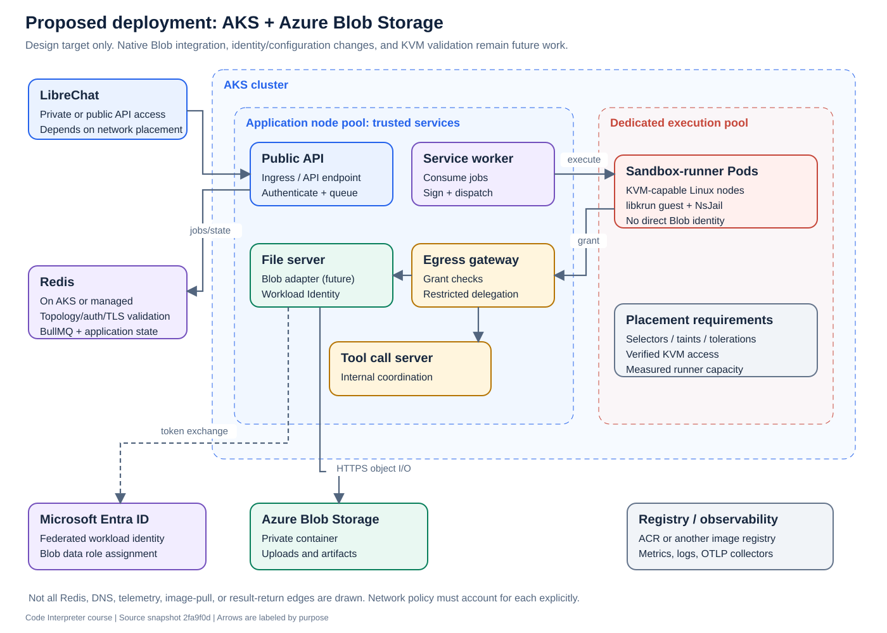
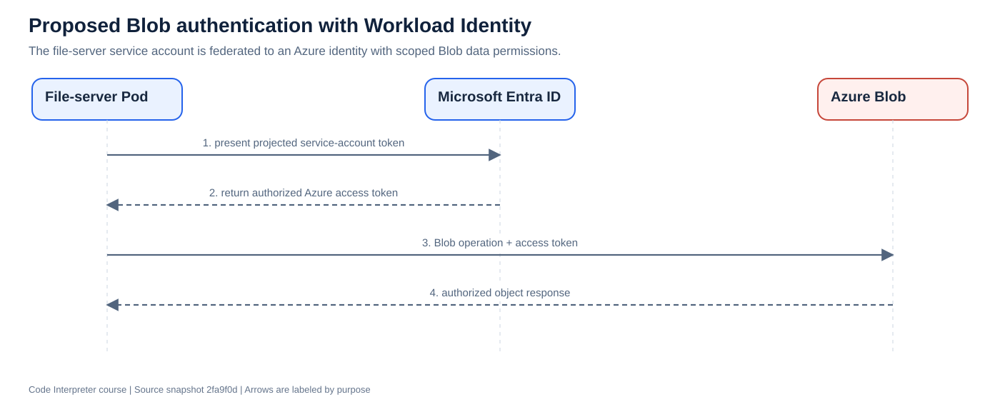

# 10. Design the Azure deployment

[Previous](09-operations.md) · [Course home](README.md) · [Next](11-migration.md)

**Objective:** Explain a proposed AKS + Azure Blob architecture and identify the assumptions that still need validation.

**Status: proposed design.** The source snapshot has Kubernetes deployment support and an AWS-free HTTP execution backend. It does not have a native Azure Blob file-storage backend or a verified AKS deployment profile.

## Choose the initial feature scope

The smallest coherent Azure target is ordinary stateless HTTP execution with persistent artifacts. Keep the existing sandbox backend and isolation model; move the Kubernetes workloads to AKS; adapt file storage to Blob.

Stateful Lambda environments, checkpoints, and hosted apps are separate scope decisions. A full feature-parity migration would need additional lifecycle and persistence designs. An Azure Function is not automatically equivalent to the repository's Lambda MicroVM APIs.

## Proposed topology

| Part | Proposed placement | Reason |
|---|---|---|
| Public API, workers, gateway, file/tool servers | AKS application pool | Ordinary application services |
| Sandbox runners | Dedicated KVM-capable AKS pool | Specialized execution and isolation requirements |
| Artifacts and uploaded files | Private Blob container | Durable object storage |
| Job/ownership coordination | Compatible Redis deployment | Preserve BullMQ and application semantics |
| Container images | ACR or another approved registry | Versioned image distribution |
| Secrets and signing material | Managed secret delivery, potentially Key Vault | Controlled delivery to the correct services |
| Metrics/traces | Existing Prometheus/OTLP-compatible collectors or Azure integration | Operational visibility without changing execution semantics |

Only the public API needs a caller-facing endpoint for the initial design. The runner, file server, gateway, and tool server remain internal. Whether the public API is internet-facing or private to LibreChat depends on where LibreChat runs.

## The KVM decision comes early

AKS itself does not guarantee usable nested virtualization on every node. VM SKU, host security settings, OS/kernel, device access, permissions, and node configuration must align.

Microsoft's [AKS engineering guide](https://blog.aks.azure.com/2026/02/06/kubevirt-on-aks) describes nested virtualization using suitable VM SKUs. This supports the feasibility of investigating KVM on AKS; it does not validate libkrun/NsJail on a particular pool. KubeVirt is not a required replacement component for this project.

The evidence needed is concrete: a runner can access KVM as intended, boot its guest, execute concurrent isolated jobs, reach the gateway through DNS, enforce limits, and clean up. A VM-family feature list alone cannot establish all of that.

## Blob Storage is a protocol adaptation

S3 and Blob are different APIs. Pointing `MINIO_ENDPOINT` at a Blob hostname cannot translate object operations or authentication.

The proposed adapter would preserve the file server's outward behavior while mapping container existence, streaming uploads/downloads, prefix listings, metadata, and deletes to Blob operations. Azure's [JavaScript upload API](https://learn.microsoft.com/en-us/azure/storage/blobs/storage-blob-upload-javascript) includes streams and buffers, but using those primitives is only part of preserving this application's contract.

Metadata needs explicit mapping because Azure restricts metadata names. Original filenames, read-only flags, and version markers must survive. Error mapping must distinguish missing files from authorization or networking failures. ETags and application version markers have different roles and should not be treated as interchangeable content hashes. See [Blob metadata documentation](https://learn.microsoft.com/en-us/azure/storage/blobs/storage-blob-properties-metadata-javascript).

## Give the file server its own Azure identity

AKS Workload Identity exchanges a projected Kubernetes service-account token for an Entra token associated with an authorized identity. The file server uses that identity for Blob operations. This requires OIDC/workload identity configuration, a federated credential, appropriate service-account/Pod settings, and Blob data permissions. The SDK must actually use that credential flow. [Microsoft's deployment guide](https://learn.microsoft.com/en-us/azure/aks/workload-identity-deploy-cluster) documents those pieces.

Grant only the needed Blob data scope. The sandbox runner continues using gateway grants and does not receive this identity. Key Vault integration is a possible secret-delivery choice; it is not already implemented simply because the application runs on Azure.

## Redis requires an explicit compatibility decision

This source creates ordinary `IORedis` clients and uses BullMQ, Pub/Sub, transactions/scripts, and multi-key application logic. A managed Redis endpoint must support the actual combination of commands, key distribution, TLS, authentication, connection count, and persistence requirements.

Azure Managed Redis offers different [clustering policies](https://learn.microsoft.com/en-us/azure/redis/choose-clustering-policy). A single-looking endpoint does not by itself prove every multi-key script is compatible. Select a topology through tests; do not assume default OSS clustering works with this client configuration. Token-based authentication would also need credential refresh support if selected.

The current Helm templates do not propagate `REDIS_TLS` to all services, and existing TLS blocks disable certificate verification. Those are concrete configuration/security gaps to assess for Azure.

## Networking is part of conversion

The current file-server NetworkPolicy permits DNS, configured Redis egress, optional telemetry, and MinIO traffic when enabled. It does not already permit all external Blob and Entra traffic.

The proposed design needs DNS resolution and allowed HTTPS paths to Blob and identity endpoints. With private endpoints, private DNS and routing must resolve correctly inside AKS. Standard Kubernetes NetworkPolicy matches IPs/selectors/ports, not arbitrary DNS names. Choose an enforcement strategy that fits actual endpoint addressing.

## Read and design

Compare the [file-server template](../../helm/codeapi/templates/file-server-deployment.yaml), [network policy](../../helm/codeapi/templates/network-policy.yaml), [`minio-client.ts`](../../service/src/minio-client.ts), and [Redis setup](../../service/src/queue.ts) with the proposal.

**Exercise:** Draw an Azure resource map. For each connection, write the destination, port, identity, and permission. Mark every assumption not established by the source.

**Checkpoint:** What are the three independent requirements for a file-server Pod to download a private Blob: identity, authorization, and what else?
