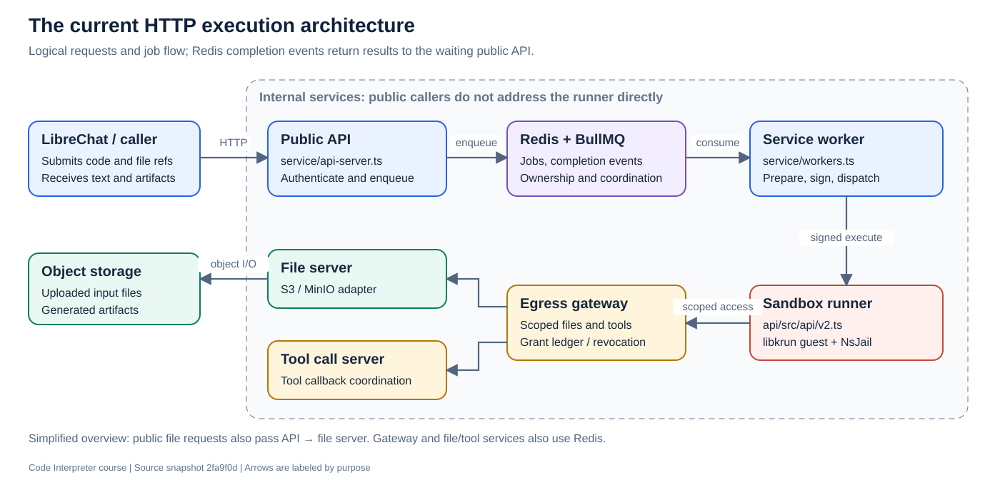

# From code execution to an Azure deployment

A guided course through this Code Interpreter repository, starting with the basics and ending with a proposed AKS and Azure Blob Storage architecture.

**Start here:** [Lesson 1: What a code interpreter actually does](01-foundations.md).

This is learning material and a design assessment. The Azure sections describe a proposal, not an implemented or validated deployment. Exercises use reading, tracing, and design work; running the service or creating Azure resources is not required.

## What you will be able to explain

- How a code string becomes a bounded operating-system process.
- How the public API, Redis, workers, sandbox, gateway, and storage cooperate.
- Which HTTP operations exist and which internal functions implement the main paths.
- What persists between requests, what is temporary, and who authorizes access.
- How Docker images become Kubernetes deployments through Helm.
- Which parts can move to AKS unchanged, which need adaptation, and what must be proved before deployment.

Arrows in this overview show principal requests and job flow. Completion returns through the worker and Redis to the waiting API. It is not a complete network-policy map; see Lesson 6 for the trust boundaries.

## Learning path

Allow roughly 8–10 hours including exercises, spread across several sessions. The times are study estimates, not benchmark results. No Kubernetes or Azure knowledge is assumed; basic programming and familiarity with files are enough.

| Lesson | What you learn | Study time |
|---|---|---|
| [1. Foundations](01-foundations.md) | Interpreter, process, API, job, container, VM | 25 min |
| [2. Repository and service map](02-repository-map.md) | Where each component lives and starts | 30 min |
| [3. Trace one execution](03-execution.md) | Request → queue → worker → sandbox → response | 50 min |
| [4. Inside the sandbox](04-sandbox.md) | Validation, priming, execution, artifacts, cleanup | 50 min |
| [5. Files and state](05-files-and-state.md) | Uploads, identities, metadata, sessions, durability | 45 min |
| [6. Security boundaries](06-security.md) | Authentication, manifests, grants, isolation | 45 min |
| [7. Tools and advanced features](07-tools-and-backends.md) | Programmatic tools, backends, bridge, hosted apps | 50 min |
| [8. Docker to Kubernetes](08-deployment.md) | Images, Compose, Pods, Services, Helm | 45 min |
| [9. Operating the system](09-operations.md) | Capacity, deadlines, failures, metrics, rollouts | 40 min |
| [10. Proposed Azure architecture](10-azure-design.md) | AKS, KVM, Blob, Redis, identity, networking | 50 min |
| [11. Migration assessment](11-migration.md) | Conversion work, verification gates, rollback | 45 min |
| [12. Capstone](12-capstone.md) | Explain and design a complete deployment yourself | 60 min |

Each lesson contains an objective, an explanation, source-reading links, an exercise, and a checkpoint. Attempt the checkpoints before opening the [answer guide](answers.md).

## Reference desk

- [HTTP API reference](api-reference.md): public operations and internal interfaces, with visibility and feature gates.
- [Route registration index](route-index.md): source locations for literal Express routes, including bridge protocol paths.
- [Function atlas](function-atlas.md): important functions, their inputs/outputs, and how they collaborate.
- [Source symbol index](symbol-index.md): generated inventory of named TypeScript functions and class methods, including less central areas.
- [Glossary](glossary.md): plain-language definitions.
- [Answer guide](answers.md): model answers and capstone rubric.
- [Diagram gallery](diagrams/README.md): standalone SVG graphics and their editable source.

“Available functions” has two meanings here. The API reference describes operations a caller can request. The function atlas describes functions inside the implementation. An exported TypeScript function is not automatically an HTTP endpoint or a user permission.

## The example used throughout

A user asks LibreChat to analyze `sales.csv`. Code API receives Python that reads the CSV, computes total sales, and writes `/mnt/data/chart.png`. The caller receives text and a file reference, then downloads the image.

The language model and LibreChat's conversation loop are outside this repository's execution core. Code API executes submitted code; it does not need to generate that code itself.

## Evidence and reading conventions

Repository explanations were checked against commit `2fa9f0d43e8e38b7d6240bc76e2483c6a47c64c7`. Relative source links point to this checkout. Line anchors are useful on GitHub; local Markdown viewers may open the file without jumping to the line. Source files and active templates take precedence over stale comments and OpenAPI descriptions.

**Current behavior** means behavior visible in this source snapshot. **Proposed Azure design** means an architectural choice to evaluate. **Illustrative** means a teaching example rather than a complete API transcript.

Azure references were consulted on 25 October 2026. SKU availability, service limits, and identity support must be checked again for the actual region and deployment date. No live Azure or KVM deployment was tested while creating this course.

The [root README](../../README.md), [Helm guide](../../helm/codeapi/README.md), [remote-bridge guide](../remote-bridge/README.md), and [Lambda guide](../lambda-microvm/README.md) provide complementary operational detail.
