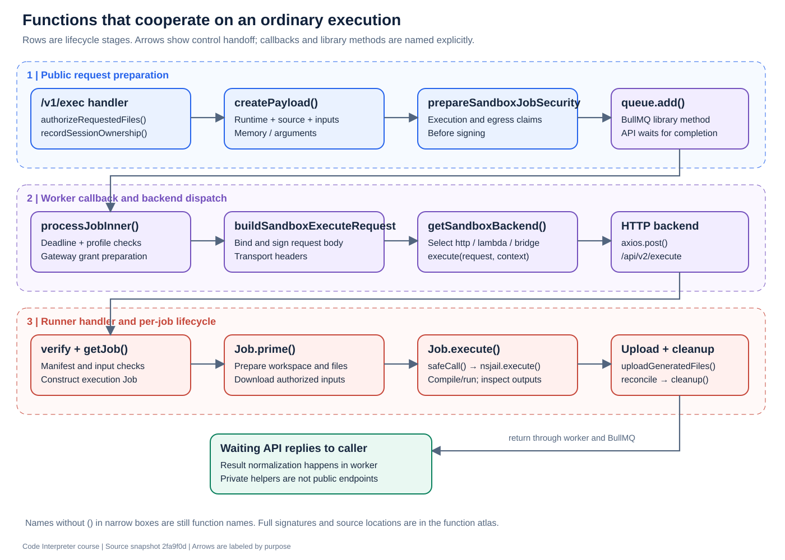

# Function atlas: who calls what, and why

[Course home](README.md) · [API operations](api-reference.md) · [Complete named TypeScript symbol index](symbol-index.md)

The tables describe meaningful input/output contracts, not verbatim TypeScript signatures. Internal helpers can change. A function marked private/module-local is explained for reading the implementation, not offered as a supported external API.

## 1. Prepare an ordinary public request

The caller enters the anonymous `/exec` handler in [`service/router.ts`](../../service/src/service/router.ts#L171). The handler orchestrates the following helpers, then invokes BullMQ:

| Function | Input → output | Responsibility / collaborator |
|---|---|---|
| [`resolveLanguage`](../../service/src/config.ts) | Language string → supported language or undefined | Select configuration before payload creation |
| [`getExecutionIdentity`](../../service/src/execution-identity.ts) | Authenticated request + user context → execution identity | Propagate trusted namespace and principal source |
| [`authorizeRequestedFiles`](../../service/src/service/file-authorization.ts) | Request, file refs, ownership store → authorized refs | Prevent unauthorized input reuse |
| [`resolveOutputBucketSessionKey`](../../service/src/session-key.ts) | Authenticated request → output ownership key | Derive private output namespace |
| [`recordSessionOwnership`](../../service/src/session-ownership.ts) | Store, session ID, owner key → write completion | Register session ownership before work |
| [`createPayload`](../../service/src/payload.ts) | Request + plotting/session context → runner payload | Source files, runtime, arguments, limits, input refs |
| [`prepareSandboxJobSecurity`](../../service/src/sandbox-egress.ts) | Payload + identity/scope → security preparation | Prepare execution/egress claims; not the final transport signing step |
| `queue.add` | Job data + options → BullMQ Job | External BullMQ library; enqueue |
| `job.waitUntilFinished` | QueueEvents + wait timeout → result | External BullMQ library; wait for completion |

## 2. Consume and dispatch a queued job

| Function | Input → output | Responsibility / collaborator |
|---|---|---|
| [`processJob`](../../service/src/workers.ts#L68) | BullMQ execution Job → public execution result | Module-local worker callback; trace wrapper around `processJobInner` |
| [`processJobInner`](../../service/src/workers.ts#L87) | Queued execution → normalized result | Deadline, profile validation, grant, backend call, result restoration, cleanup |
| [`jobDeadlineAtMs`](../../service/src/config.ts) | Enqueue/budget/deadline context → absolute deadline | Keep queue wait within the execution budget |
| [`createGatewayEgressGrant`](../../service/src/egress-gateway-client.ts) | Payload + refreshed claims + cancellation → scoped payload/grant | Ask gateway to prepare restricted file/tool access |
| [`prepareInputDelivery`](../../service/src/runtime-session/input-delivery.ts) | Original + scoped payloads → body/input delivery refs | Keep privileged fetch information out of the signed sandbox body |
| [`buildSandboxExecuteRequest`](../../service/src/sandbox-dispatch.ts) | Payload + claims + signing settings → body/headers | Bind claims to request body and sign |
| [`resolveRuntimeSessionForJob`](../../service/src/runtime-session/job-policy.ts) | Queued session decision + worker capabilities → session context | Reject incompatible stateful/stateless consumption |
| [`getSandboxBackend`](../../service/src/sandbox-backend/index.ts) | Configuration → selected backend singleton | Choose/lazily load implementation |
| [`HttpSandboxBackend.execute`](../../service/src/sandbox-backend/http.ts) | Signed request + context → raw runner response | `axios.post`, trace propagation, abort signal |
| [`restoreGatewaySandboxResult`](../../service/src/egress-gateway-client.ts) | Scoped result + grant information → restored result | Return gateway handles to caller-facing identities |
| [`revokeGatewayEgressGrant`](../../service/src/egress-gateway-client.ts) | Grant identity/reason → revocation completion | End scoped authority on completion/failure paths |

The gateway client functions make HTTP calls. They do not execute in the same process as the gateway's grant handlers. `execute()` is a shared interface method name across three backends, not one universal local function.

## 3. Execute inside the runner

| Function/method | Input → output | Responsibility / collaborator |
|---|---|---|
| [`verifyExecuteRequestManifest`](../../api/src/execution-manifest-request.ts) | Token/body/verifier settings → verified claims | Check integrity and scope before constructing a Job |
| [`getJob`](../../api/src/api/v2.ts#L284) | Runner body + scoped context → execution Job | Module-local validation/runtime selection |
| [`validateExecuteFiles`](../../api/src/api/v2.ts) | File descriptors → validation or error | Check source/input structure |
| [`validateExecuteArguments`](../../api/src/api/v2.ts) | Arguments/stdin → validation or error | Reject unsupported shapes |
| [`sanitizeEnvVars`](../../api/src/api/v2.ts) | Requested environment → permitted environment | Validate environment input before execution |
| [`Job.prime`](../../api/src/job.ts#L935) | Job configuration → prepared workspace | Acquire identity/workspace, write sources, prepare inputs |
| [`Job.downloadAndWriteFile`](../../api/src/job.ts#L1287) | Input descriptor → local file | Resolve/download authorized bytes and write safely |
| [`Job.execute`](../../api/src/job.ts#L1655) | Primed Job → compile/run results and candidate file refs | Compile if needed, run, inspect workspace |
| [`Job.safeCall`](../../api/src/job.ts#L1610) | Runtime script/args/limits → NsJail process result | Build environment/command; call NsJail supervisor |
| [`nsjail.execute`](../../api/src/nsjail.ts#L252) | Execution options → captured process result | Start/supervise bounded child and capture stdout/stderr |
| [`buildArgs`](../../api/src/nsjail.ts#L672) | NsJail options → CLI argument array | Encode runtime/workspace/identity/limit settings |
| [`Job.uploadGeneratedFiles`](../../api/src/job.ts#L2579) | Discovered artifacts → IDs actually uploaded | Bound concurrency and aggregate successful delivery |
| [`reconcileArtifactDelivery`](../../api/src/delivery.ts) | Candidate refs + generated IDs + delivered IDs → retained refs/failure | Prevent unavailable artifacts from appearing delivered |
| [`Job.cleanup`](../../api/src/job.ts#L2718) | Job resources → cleanup completion | Dispose of workspace and release identity appropriately |

`Job.execute()` uses private artifact-walking methods inside `Job`; see the symbol index for `handleSessionFiles`, `walkDir`, `handleRegularFile`, and `uploadOneFile`. The route, rather than `Job.execute()` alone, owns the full upload-and-cleanup sequence.

## 4. Discover runtime packages and isolate workspaces

| Function | Input → output | Role |
|---|---|---|
| [`loadPackages`](../../api/src/runtime.ts) | Packages directory → loaded runtime registry | Startup scans installed packages |
| [`loadPackage`](../../api/src/runtime.ts) | One package directory → registry update | Load package metadata and environment |
| [`getLatestRuntimeMatchingLanguageVersion`](../../api/src/runtime.ts) | Language/version requirement → selected runtime | Choose installed executable environment |
| [`getRuntimes`](../../api/src/runtime.ts) | Registry → runtime descriptors | Internal discovery response |
| [`initializeSandboxWorkspaceIsolation`](../../api/src/workspace-isolation.ts) | Configured environment → initialized isolation | Validate and prepare workspace/identity handling |
| [`createSandboxWorkspace`](../../api/src/workspace-isolation.ts) | Workspace/identity options → workspace lease | Create isolated job workspace |
| [`cleanupSandboxWorkspace`](../../api/src/workspace-isolation.ts) | Workspace lease → removal status | Clean workspace safely |
| [`startWorkspaceReaper`](../../api/src/workspace-isolation.ts) | Configured lifecycle → stop callback | Retry/reap stale workspace state |

The Rust [launcher `main`](../../launcher/src/main.rs) configures libkrun, resources, guest environment, and VM execution. It is an entrypoint beneath the runner image, not a TypeScript helper called for each user request.

## 5. Resolve, store, and download files

| Function/method | Input → output | Responsibility / collaborator |
|---|---|---|
| [`createMinioClient`](../../service/src/minio-client.ts) | Storage environment → MinIO/S3 client | Static credential or IRSA construction; current provider |
| [`uploadFile`](../../service/src/file-server.ts#L203) | Session, stream, filename/type, optional ID/read-only → upload result | Module-local streaming upload and metadata/index handling |
| [`storageKeyForUpload`](../../service/src/file-object-resolver.ts) | Session, ID, extension, replacing flag → object key | Canonical replacement versus legacy key layout |
| [`canonicalObjectKey`](../../service/src/file-object-resolver.ts) | Session + logical ID → canonical object key | Stable replacement identity |
| [`FileObjectResolver.resolve`](../../service/src/file-object-resolver.ts) | Session + ID → object key or undefined | Check locator hint or locate authoritative object |
| [`FileObjectResolver.metadata`](../../service/src/file-object-resolver.ts) | Session + ID → current key/stat or undefined | Fresh object metadata with recovery |
| [`FileObjectResolver.recover`](../../service/src/file-object-resolver.ts) | Missing locator → replacement locator or undefined | Recover after stale index/missing key |
| [`FileObjectResolver.listFresh`](../../service/src/file-object-resolver.ts) | Session + ID → exact matching keys | Enumerate canonical/legacy identity for replace/delete |
| [`FileObjectResolver.remember`](../../service/src/file-object-resolver.ts) | Identity + key → optional hint write | Best-effort index publication |
| [`mapObjectDetails`](../../service/src/file-object-resolver.ts) | Object iterable + async mapper/concurrency → details | Bound metadata fan-out while listing |
| [`sendFileDownload`](../../service/src/file-download.ts) | GET stream + HTTP response + optional expected version → completed transfer | Version check, headers, stream cancellation |

`putObject`, `getObject`, `statObject`, `listObjects`, and `removeObject` are MinIO SDK methods in the current implementation. A proposed Blob adapter must map their relevant behavior rather than assume Blob speaks S3.

## 6. Programmatic calls and cancellation

| Function | Input → output | Role |
|---|---|---|
| [`createProgrammaticPayload`](../../service/src/preamble.ts) | Programmatic execution settings → wrapped sandbox payload | Add runtime tool plumbing/history |
| [`generateReplayPreamble`](../../service/src/preamble.ts) | Replay wrapper configuration → source text | Expose tools and consume recorded results |
| [`extractPendingFromControlPayload`](../../service/src/preamble.ts) | Trusted control payload → pending calls | Prefer structured control output where available |
| [`extractPendingFromStdout`](../../service/src/preamble.ts) | Captured output → extracted pending calls | Parse supported fallback representation |
| [`buildReplayExecutionState`](../../service/src/service/programmatic-state.ts) | Execution inputs → stored replay state | Retain routing and workflow continuity |
| [`requestJobCancellation`](../../service/src/job-cancellation.ts) | Redis + target + retention → accepted status | Coordinate cancellation across replicas |
| [`claimJobExecution`](../../service/src/job-cancellation.ts) | Target/retention → execution claim or committed result | Prevent conflicting execution/result handling |
| [`commitJobResult`](../../service/src/job-cancellation.ts) | Target + result → commit outcome | Fence cancellation/completion races |
| [`createWorkspaceToolsRouter`](../../service/src/workspace-tools/router.ts) | Store/capabilities/lifecycle options → Router | Construct workspace operation handlers |

## 7. Stateful and optional subsystems

| Function/class | Responsibility | Azure relevance |
|---|---|---|
| [`LambdaMicrovmSandboxBackend.execute`](../../service/src/sandbox-backend/lambda-microvm.ts) | Launch/reuse supported AWS environments, execute and manage session lifecycle | AWS-specific backend |
| [`RemoteBridgeSandboxBackend.execute`](../../service/src/sandbox-backend/remote-bridge.ts) | Dispatch fenced work to an attached outbound worker | Provider-neutral transport; host/runtime still need design |
| [`acquireRuntimeSessionLock`](../../service/src/runtime-session/registry.ts) | Acquire token-owned Redis session lock | Session serialization, not an object-storage API |
| [`renewRuntimeSessionLock`](../../service/src/runtime-session/registry.ts) | Extend ownership while valid | Protect long work from overlapping owners |
| [`releaseRuntimeSessionLock`](../../service/src/runtime-session/registry.ts) | Release only the owned lock | Avoid deleting a newer owner's lock |
| [`allocateRuntimeSessionGeneration`](../../service/src/runtime-session/registry.ts) | Allocate fencing generation | Reject stale lifecycle owners |
| [`MinioCheckpointStore`](../../service/src/runtime-session/checkpoint-store.ts) | Store/read/commit checkpoint revisions using S3 SDK | Separate storage adaptation if checkpoint parity is required |
| [`RedisBridgeStore`](../../service/src/bridge/store.ts) | Workers, leases, settlement, workspace ownership and fencing | Redis command/durability compatibility matters |

## Reading patterns

- A route callback orchestrates helpers; its lack of a function name does not make it unimportant.
- An `async` function returns a Promise; a caller generally awaits completion before using its result.
- A class method such as `Job.execute()` depends on state prepared on the instance.
- An interface describes a contract; it does not execute anything by itself.
- An exported helper is callable by modules, not automatically by an HTTP caller.
- A shutdown hook, per-job cleanup, and storage deletion are three different lifecycle operations.

For every unfamiliar function, answer: who calls it, what authority does it receive, what state does it change, what happens if it fails, and who cleans up afterward?
